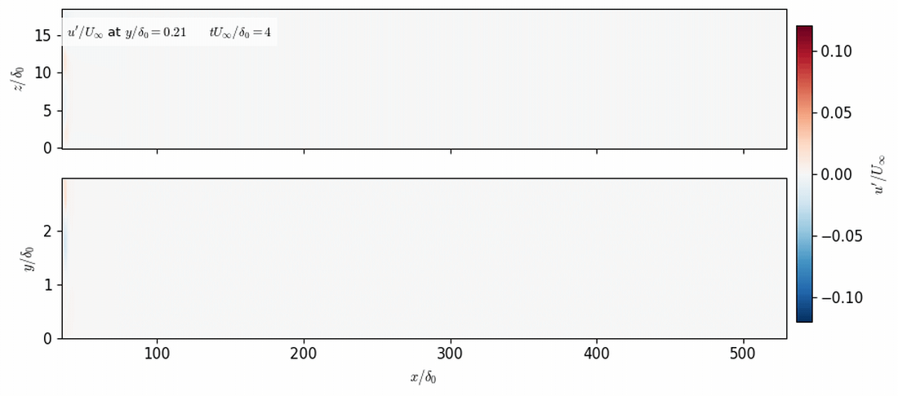
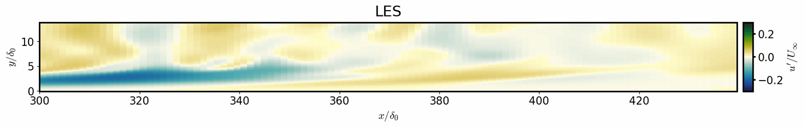

# Boundary layer solver

An incompressible boundary-layer DNS and LES solver written in CUDA Fortran.
It runs on one GPU by default and on several GPUs with a spanwise slab
decomposition. A test harness checks every change for the same physics and
records the measured speed.

The solver computes spatially developing flat-plate boundary layers:
laminar, transitional (Tollmien-Schlichting modes or bypass transition under
free-stream turbulence from a precursor inflow library) and turbulent. The
discretization is second-order staggered finite differences with explicit
Euler, RK2 or RK3 stepping and a fractional-step projection. The Poisson
equation is diagonalized by a half-length real cosine transform in $x$ and a
Fourier transform in $z$, and solved by the Thomas algorithm in $y$. The
fields stay resident on the GPU; the host is used for gated statistics,
monitoring and I/O.

<picture>
  <source media="(prefers-color-scheme: dark)" srcset="docs/img/tbl_hit_transition_dark.gif">
  
</picture>

*Bypass transition of a flat-plate boundary layer under 3% free-stream
turbulence (precursor inflow library), computed on two A100 z-slabs:
$u'/U_\infty$ in a wall-normal $x$-$y$ plane at equal aspect ratio, axes in
inlet-$\delta_{99}$ units. Free-stream turbulence above drives streaks and
turbulent spots in the layer below.*

<picture>
  <source media="(prefers-color-scheme: dark)" srcset="docs/img/tbl_hit_transition_les_dark.gif">
  
</picture>

*The same case computed as a wall-resolved LES (dynamic Smagorinsky,
`LES = 2`) on a 12x coarser grid with double the time step, shown at the
same instants as the DNS above. The streak growth and breakdown follow the
same scenario at about 8x lower compute cost: one GPU for 51 minutes against
two GPUs for 3.4 hours.*

## Repository layout

```
src/          the CUDA Fortran solver          -> boundary_layer_cuda
cases/        runnable cases: laminar/, transition/, turbulent_lund/,
              profiles/ (mean-profile data used by inflow generators)
tests/        try the code + the gating harness: physics pass/fail,
              field-level diffs, timing
docs/         design documents, parameter reference, validation records
```

The earlier CPU (MPI) and OpenACC implementations are kept in git history
on the `gpu-openacc` branch. `main` is CUDA-only.

## Build and run

Requires the NVIDIA HPC SDK (nvfortran, 24.3+) and a cc80+ GPU.

```bash
cd src && make                    # -> ./boundary_layer_cuda at the repo root
cd ..
mpirun -np 1 ./boundary_layer_cuda -i cases/laminar/laminar.turbb
```

`make DEBUG=1` builds with bounds checks and per-kernel launch-error
checking. Multi-GPU runs are experimental. They require `nx-2` and `nz-2`
divisible by the rank count and the UCX CUDA transports:

```bash
CUDA_VISIBLE_DEVICES=0,1 mpirun -np 2 --mca pml ucx \
  -x UCX_TLS=self,sm,cuda_copy,cuda_ipc -x UCX_MEMTYPE_CACHE=n \
  ./boundary_layer_cuda -i case.turbb
```

The Poisson FFT lengths are `nx-2` and `nz-2`. Choose them with small prime
factors (2, 3, 5, 7). A large prime factor, for example `812 = 4*7*29`,
sends cuFFT onto a slow path and costs about 10% per step.

## Tests

The fastest end-to-end check is the laminar Blasius case, about 8 s on an
A100. The same harness gates every solver change; see
[tests/README.md](tests/README.md) for the method and the full baseline and
result tables.

```bash
python3 tests/validate.py laminar --exe ./boundary_layer_cuda --label my-run
python3 tests/validate.py compare --a openacc-ref --b my-run
python3 tests/validate.py bench   --exe ./boundary_layer_cuda --label my-run
```

- `laminar`: Blasius case with numeric checks (Cf against the similarity
  solution and a golden value, divergence at machine zero, free-stream
  cleanliness). It runs in seconds.
- `compare`: field-by-field diff between two builds or runs, plus speedup.
- `bench`: production-sized grid, ns/cell/step.

## Cases

| case | what it is |
|---|---|
| `cases/laminar` | Blasius flat plate; the correctness gate (about 8 s on an A100) |
| `cases/transition` | K-type transition from Tollmien-Schlichting inflow modes |
| `cases/turbulent_lund` | turbulent boundary layer with Lund recycling inflow (`inflow_flag = 3/5`), ported and validated to machine precision against the CPU solver; see [cases/turbulent_lund/README.md](cases/turbulent_lund/README.md) |

Input files are `key = value` text files (`.turbb`); see the commented
examples in each case directory and the parameter table in
[docs/input_parameters.turbb](docs/input_parameters.turbb). String values
must follow `=` without a blank, as the shipped cases do.

## Physics and models

The solver integrates the incompressible Navier-Stokes equations with
$U_\infty = 1$ and the inlet distance from the leading edge as the unit of
length, so the inlet Reynolds number is $1/\texttt{nu}$. The streamwise
direction has an inflow and an outflow, the wall-normal direction has the
wall and a top boundary, and the spanwise direction is periodic. The tables
list every option the code accepts, the input key that selects it, and how
it has been checked. The status column uses four levels. Physical means
compared with a known solution or with published data. Reference means
agreement with the original CPU solver, started from the same restart file,
to round-off. Ported means the option runs but no comparison is recorded.
Not exercised means the option runs as in the CPU solver but no case in this
repository has carried it to a physical result. The
equations behind each option are in
[docs/PHYSICS_AND_MODELS.md](docs/PHYSICS_AND_MODELS.md).

Inflow, `inflow_flag`:

| value | inflow | status |
|---|---|---|
| 1 | Blasius profile plus temporal Tollmien-Schlichting modes (none if no mode file) | physical: Blasius $C_f$ in the laminar gate, 500k-step K-type transition; reference: $2\times10^{-14}$ |
| 2 | mean $u$, $v$ profiles read from a file | reference: $2.0\times10^{-14}$ |
| 3 | Lund recycling of a downstream plane, full field rescaled | reference: $\le 2.5\times10^{-13}$ |
| 4 | Blasius profile plus random noise redrawn every step | ported: the random sequence differs from the CPU solver by construction |
| 5 | turbulent mean profile from a file plus rescaled Lund fluctuations | reference: $\le 2.5\times10^{-13}$ |
| 6 | Blasius profile plus time-resolved planes from a precursor HIT library | physical: bypass transition at $Tu = 2\%$, $C_f$, $H$ and $u'_{rms}$ against Wu (2025); reference: $2.2\times10^{-14}$ |

Top boundary, `top_flag`:

| value | top boundary | status |
|---|---|---|
| 0 | Dirichlet free stream, $u = 1$, $v$ from the Blasius edge value, $w = 0$ | physical: Blasius $C_f$ in the laminar gate |
| 1 | blowing and suction lid, Coleman et al. (2018) form, zero spanwise vorticity | reference: $\le 2.5\times10^{-13}$ |
| 2 | blowing and suction lid, Abe (2017) form, zero spanwise vorticity | ported |
| 3 | Falkner-Skan free stream, $u \propto x^{\beta/(2-\beta)}$ set by `beta_hartree` | reference: $2.2\times10^{-14}$ |
| 4 | zero shear, $\partial u/\partial y = \partial w/\partial y = 0$, $v$ imposed | reference: $2.2\times10^{-14}$ on a production grid |

The wall is no-slip unless a wall model is active. The outflow is a
first-order convective condition with a global mass correction.

Subgrid-scale model, `LES`:

| value | model | status |
|---|---|---|
| 0 | none (DNS) | physical: laminar gate, transition, bypass transition |
| 1 | constant-coefficient Smagorinsky, $C_s = 0.11$, $\Delta = (\Delta x\,\Delta y\,\Delta z)^{1/3}$ | reference: $4.2\times10^{-15}$ |
| 2 | dynamic Smagorinsky, coefficient averaged over the spanwise slab | reference: bitwise at matched decomposition; used for the LES row in the figure above |
| 3 | dynamic Smagorinsky, pointwise coefficient | reference: $2.1\times10^{-15}$ |

All subgrid models run on the GPU, and the eddy viscosity is clipped at zero.

Wall model, `WM` (0 is a no-slip wall):

| value | wall model | status |
|---|---|---|
| 1 | slip length from a momentum integral | reference: $10^{-15}$ |
| 2 | dynamic slip length (Bose type) | reference: $10^{-15}$ |
| 3 | least-squares Robin fit on grid and test-filtered fields | reference: machine precision |
| 4 | slip length from the momentum balance at the wall | reference: $2.9\times10^{-10}$ |
| 5 | prescribed, optionally oscillating slip lengths (`alphas`) | reference: machine precision |
| 6 | log layer with the resolved eddy viscosity | not exercised |
| 7 | dynamic momentum balance | reference: machine precision |
| 8 | log layer with a fixed eddy viscosity | not exercised |
| 9 | wall stress from a $C_f$ correlation, imposed through $u$ and $v$ | not exercised |
| 11 | Neumann wall stress from the momentum balance and `TauwModel` | reference: machine precision |
| 12 | wall stress from a $C_f$ correlation, imposed through $u$ | not exercised |
| 13 | wall stress from a $C_f$ correlation, imposed by wall transpiration | not exercised |
| 14 | as 13, with a pseudo-Robin condition on $v$ | not exercised |
| 15 | exact Neumann wall stress from a $C_f$ correlation | reference: machine precision |

`TauwModel` selects the wall-stress estimate used by `WM = 11`: 0 takes a
$C_f$ correlation and 1 solves the log law by Newton iteration (reference:
machine precision). The wall-model code runs on the host and is bridged to
the GPU at every substep. No wall model has been compared with
boundary-layer data, and models 6, 8, 9, 12, 13 and 14 divide by zero on
every input tried, in this code and in the CPU solver alike. Two memory
errors found in the CPU wall models during the port are repaired in both
codes.

Time stepping, `RKscheme`: 1 is forward Euler (reference: $2.4\times10^{-15}$),
2 is a two-stage Runge-Kutta scheme, and 3 is a three-stage Runge-Kutta
scheme. A negative `CFL` fixes the time step. Restart, statistics, box
output and strided 3-D snapshots are described in the same document.

## Documentation

- [docs/PHYSICS_AND_MODELS.md](docs/PHYSICS_AND_MODELS.md): governing
  equations and numerics, every boundary condition, LES and wall-model
  option with its input keys, output formats, and the features that exist
  only on branches.
- [docs/CUDA_PORT_DESIGN.md](docs/CUDA_PORT_DESIGN.md): the port's design
  contract: module layout, verbatim-numerics and determinism conventions.
- [docs/MULTI_GPU_DESIGN.md](docs/MULTI_GPU_DESIGN.md): the multi-GPU
  architecture, implementation status and measured scaling, including what
  does not scale on PCIe and why.
- [tests/README.md](tests/README.md): test and validation method and the
  record of baselines and results.

## Performance summary (A100-PCIE-40GB, nvfortran 24.3)

Speedup of one A100 GPU over the original CPU solver (16-core MPI):

| case | CPU solver (MPI) | CUDA solver | speedup |
|---|---|---|---|
| transition 814x125x66, production cadence | 87 ms/step (16 cores) | 10.0 ms/step (1 GPU) | 8.7x |
| laminar 302x64x8 | 25.5 ms/step (6 cores*) | 0.83 ms/step (1 GPU) | 31x |
| capacity: 3074x341x258 (270M cells, ~65 GB) | 28.1 s/step (16 cores) | 0.7-0.8 s/step (4 GPUs) | ~35-40x |

*The z-slab decomposition requires `nz-2` divisible by the rank count, so
the laminar case (nz = 8) caps at 6 ranks. CPU numbers are median
per-monitor-interval timings of the pre-port MPI solver rebuilt from this
repository's history (gfortran -O2 + FFTW 3.3.10), on the same machine as
the GPU runs (dual-socket 28-core Xeon host of the A100s).*

## Credits

Original CPU/MPI solver by Adrian Lozano-Duran (Computational Turbulence
Group, MIT). OpenACC port, CUDA Fortran rewrite and multi-GPU implementation
by Alvaro Martinez Sanchez.

## License

Not yet licensed for redistribution. Contact the authors.
